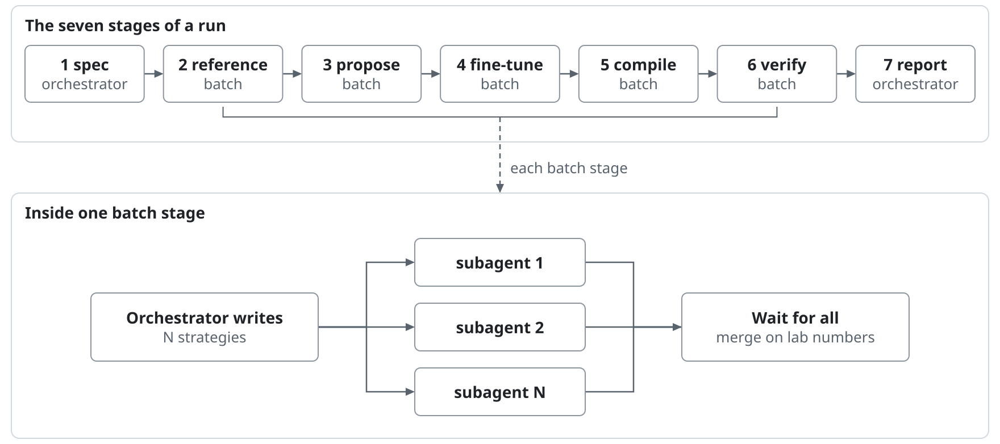
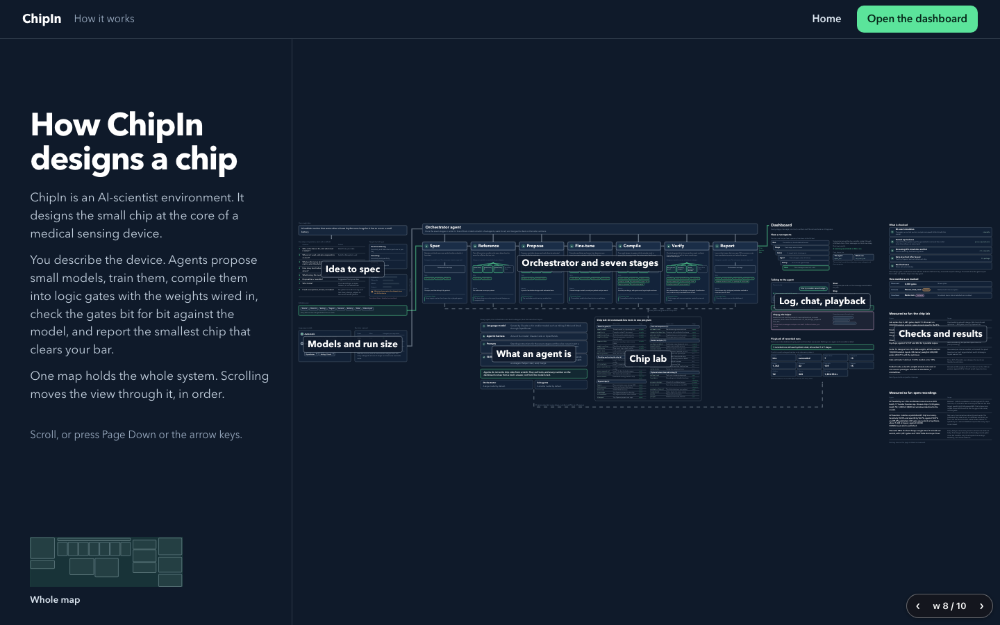

# ChipIn

ChipIn is an AI-scientist environment that designs the small, single-purpose
chip at the core of a medical sensing device. You describe the device;
agents propose and train small models, compile them into logic gates with
the weights wired in, verify the gates against the model in software, and
report the smallest design that clears your targets and where it falls
short.

- Site: <https://chipin.space>
- Quickest way to try it, no install needed: the dashboard at
  <https://chipin.space/dashboard/variants/i1.html>
- How it works, the technical map:
  <https://chipin.space/how-it-works/variants/w8.html>
- Waitlist: <https://chipin.space/waitlist/>

**Status:** four pull requests are open and not merged (#38 to #41); #40
would make the run sizes 5, 15 and 50 subagents a run with a 10-minute
limit each. This README describes `main` as it is.

## Prerequisites

| Tool   | Version                                         |
| ------ | ----------------------------------------------- |
| OS     | macOS or Linux (tested on macOS, Apple silicon) |
| `git`  | any recent version                              |
| [uv]   | any recent version (tested with 0.13.5)         |
| Python | 3.12 or newer, which uv can install (3.12.13)   |

[uv]: https://docs.astral.sh/uv/

The quick start needs no key, no model and no chip lab: it uses the stub
agent, which is scripted, calls no model and costs nothing.

## Quick start

1. Clone the code and the site (the site lives on branch `gh-pages`), and
   keep the site's absolute path in `SITE`:

   ```bash
   git clone https://github.com/AMGrobelnik/sota-hack
   git clone --depth 1 --branch gh-pages --single-branch \
       https://github.com/AMGrobelnik/sota-hack sota-hack-site
   SITE="$PWD/sota-hack-site"
   cd sota-hack/backend
   ```

2. Install the backend and its test tools:

   ```bash
   uv sync --extra dev
   ```

3. Run one stub run from the command line:

   ```bash
   uv run chipin-backend run --backend stub --prompt "hello"
   ```

   It prints the run as JSON, including `"failed": false`, and writes the
   run folder under `backend/runs/`. The log line "no OpenRouter summary
   (OPENROUTER_API_KEY is not set)" is expected without a key.

4. Serve the site and the API from your machine (any free port; the
   default is 8797):

   ```bash
   uv run chipin-backend serve --agent stub --site "$SITE" --port 8841
   ```

   Expected output:

   ```text
   ChipIn backend ready (agent stub, runner local): http://127.0.0.1:8841/#token=<token>
   Ctrl-C stops it.
   ```

   From a second terminal, `curl -s http://127.0.0.1:8841/api/health`
   answers with `"ok": true` and `"agent": "stub"`.

5. Open the dashboard on the same address with the same token:

   ```text
   http://127.0.0.1:8841/dashboard/variants/i1.html#token=<token>
   ```

   The sidebar reads "Connected to local backend" and the token leaves the
   address bar.

6. Type a brief that names the sensor and at least one target, for
   example: A wrist band with an accelerometer that detects falls; at
   least 90% sensitivity and at most 1 false alarm per day. Press Chip in
   and answer the five questions; the page may ask up to three more,
   which are canned on the stub. Pick a run size on the spec card and
   press Run. A stub run marks all seven stages done in well under a
   minute.

7. Stop the server with Ctrl-C.

Runs from the `run` command (step 3) are kept on disk, but the dashboard's
Recents list only the runs started through `serve`.

The published site cannot use a server on your machine without changing
browser settings (Chrome asks for local network access; Safari blocks it
as mixed content), so serve the site locally as above.

## How a run works


The dashboard above shows the AF patch example: a measured feasibility run
whose 2,330-gate design clears the specificity target and misses the
sensitivity target.

<picture>
  <source media="(prefers-color-scheme: dark)" srcset="docs/img/flow-system-dark.svg">
  
</picture>

1. **Brief and questions.** You type or speak a brief, then answer five
   fixed questions. With a backend connected, a small model may ask up to
   three follow-ups; each has a default and none blocks the run.
2. **Spec.** The answers become a spec card you can edit; every target is
   a bar the chosen design is judged against.
3. **Orchestrator and seven stages.** The run's agent does the spec and
   the report itself. With fan-out on, each of the other five stages is
   one batch of subagents trying different strategies at once; the
   orchestrator waits for all of them and merges the best on the lab's
   numbers. Every dashboard run turns fan-out on; the `run` command needs
   `--fanout`.
4. **Chip lab.** The agents call the lab's command-line tools: bring a
   model in, synthesise gates, count FPGA LUTs, map to cell libraries,
   check the gates in software, prove equivalence, lay out, package and
   report.
5. **Verification.** The gate netlist is proved equal to the RTL. The
   match with the model is checked in software on the inputs given.
6. **Dashboard.** Stages, messages, tool calls, designs and costs stream
   live; recorded runs play back from their events and are listed under
   Recents. You can message the agent while it runs, and Chippy, a
   separate helper, answers questions about the runs.

<picture>
  <source media="(prefers-color-scheme: dark)" srcset="docs/img/flow-stages-dark.svg">
  
</picture>

| Stage     | What it produces                                  |
| --------- | ------------------------------------------------- |
| spec      | targets, constraints and the data to use          |
| reference | baseline models to compare against                |
| propose   | candidate design families                         |
| fine-tune | trained models, if a training Python is set       |
| compile   | logic gates for each model, from the lab          |
| verify    | gates checked against the model                   |
| report    | the chosen design, its numbers and where it fails |

**Run sizes on `main`.** The run size sets the subagents in each stage
batch: 3 for Lite, 10 for Pro and 15 for Max (`backend/README.md`,
"Fan-out"). The live dashboard labels the sizes 5, 15 and 50 agents; on
`main` the backend runs the batch sizes above.

**Models.** The dashboard offers four: Opus 5.5 (the default), Sonnet 5.5,
Inkling 2 Mini and Inkling 2 Small. Each run sends the agent and model
picked (`dashboard/chipin-models.js` on `gh-pages`).



The full map, with every part labelled, is at
<https://chipin.space/how-it-works/variants/w8.html>. Other versions of the
explanation are in the gallery at <https://chipin.space/how-it-works/>.

## Tests

From `backend/`, with no network and no keys:

```bash
uv run pytest
uv run ruff check .
uv run ruff format --check .
```

`pytest` runs about 690 tests and took about 5 minutes on the machine
tested; expect `passed` with a few skipped. Known issue: one or two
timing-sensitive tests in `tests/test_summaries.py` and
`tests/test_api_server.py` sometimes time out in the full suite and pass
when run on their own.

## A real run

A real run uses the default agent, the `claude` command-line agent, on the
machine's own Claude login (CLI version 2.1.322 or newer; install it and
log in once with `claude`). It calls a paid model. From `backend/`:

```bash
uv run chipin-backend serve --site "$SITE" --env-file PATH_TO_KEYS_FILE
```

Keys are read by name from the environment, `backend/.env` or
`--env-file`, and never printed.

| Name                  | Needed for                                    |
| --------------------- | --------------------------------------------- |
| `OPENROUTER_API_KEY`  | summaries, follow-up questions, Chippy, (a)   |
| `CHIPIN_CHIPLAB_BIN`  | optional: a chip lab installed elsewhere      |
| `CHIPIN_TRAIN_PYTHON` | optional: a Python that can train             |

(a) and the `openrouter` agent, which runs the two Inkling models. That
agent also needs `uv sync --extra dev --extra openhands` and `tmux` on
`PATH`; without them `GET /api/health` lists it as unavailable and a run
that names it is refused.

The chip lab is optional. Its installer (`chiplab/README.md`, section 2)
checks out branch `ant/chip-lab`, writes `~/.config/chiplab/config.json`
and `~/.local/bin/chiplab`, and fetches yosys, iverilog, verilator and the
sky130 PDK (Docker only for layout); `chiplab doctor` lists anything
missing. To keep it out of your home folder, set `CHIPIN_CHIPLAB_BIN`,
`CHIPLAB_CONFIG` and `CHIPLAB_USER_DIR` (`backend/README.md`, "Chip lab").
The backend turns the lab on whenever `chiplab` is on the agent's `PATH`.
Without a Python that can train, the agent skips the fine-tune stage and
says why.

`backend/README.md` is the full reference: routes, events, fan-out
settings, summaries, the helper and the run modes.

## Repository layout

| Path           | What it holds                                |
| -------------- | -------------------------------------------- |
| `backend/`     | runs the agents, records runs, local API     |
| `chiplab/`     | the chip lab: model in, verified gates out   |
| `m3/`          | lab speed, install, proof and layout checks  |
| `experiments/` | baseline comparisons on open data            |
| `docs/img/`    | the images in this README                    |
| `context/`     | early idea notes (`context/README.md`)       |
| `.github/`     | lab tests and a cloud layout build           |

The site and dashboard are served from the `gh-pages` branch. The newest
chip lab is on the `ant/chip-lab` branch until it is merged here: its
`chiplab/AGENT.md` lists 44 tools, 36 core and 8 optional extras for data
and training; the copy on `main` documents 43.

## What is measured so far

Every figure below comes from the file named by its letter.

| Figure                                                    | File |
| --------------------------------------------------------- | ---- |
| AF search: 256 designs trained, 119 under cap             | B    |
| AF design: 2,330 gates, logic depth 52                    | B    |
| AF gates vs model: 3,880 of 3,880 windows equal           | B    |
| AF test: sensitivity 83.3%, specificity 87.6%             | B    |
| Training: 1,625.5 vs 27.6 candidates a minute             | B    |
| Second AF design: accuracy matches published              | C    |
| Second AF design: 831 GE at synthesis vs 24,038 published | C    |
| Neonatal EEG: best 30 of 113 held-out events              | D    |
| Recorded runs: 5, all seven stages done                   | E    |
| Recorded runs: 4 to 32 minutes each                       | E    |
| Lab spike design: 2,285 gates, depth 51                   | A    |
| Same design: 862 iCE40 LUTs                               | A    |
| Same design optimised: 1,405 gates, 1 tile (estimate)     | A    |
| Gate estimator: held-out r² 0.95                          | A    |

- A: `chiplab/README.md`, section 9 (`main`).
- B: `dashboard/data/af-candidates.json` (`gh-pages`).
- C: `dashboard/data/af-baseline.json` (`gh-pages`); method and code in
  `experiments/baselines/af/`.
- D: `dashboard/data/neonatal-eeg.json` (`gh-pages`).
- E: `dashboard/data/runs/index.json` (`gh-pages`).
- G: `how-it-works/variants/y1.html` (`gh-pages`).

**Training throughput.** 1,625.5 candidates a minute in one batch of 256,
against 27.6 one at a time on the same GPU (about 59 times), where one at
a time is slowed by launch overhead (B).

**Checks.** On the AF design, the match with the model is checked in
software on the test windows (B). In the lab, the netlist is proved equal
to the RTL, and the model match is checked in software (A, section 4).

**Design time, different scopes.** Teams without large design staffs
typically see hardware design cycles of 12 to 36 months (OpenROAD paper,
2019, as cited in G). The five recorded runs went from a brief to verified
logic gates in 4 to 32 minutes, on synthetic data (E, G). The runs include
no layout signoff, fabrication or approval, so the two are not the same
job.

## Limits

- **No chip has been fabricated.** Every chip here is a gate-level design,
  compiled and verified in software.
- **Estimates are labelled.** Unit cost, power, area and battery figures
  are estimates, and so are transistor counts and tile counts before
  layout (A, section 10).
- **The AF design misses its sensitivity target.** On held-out test
  recordings it scores 83.3% against a 90% target, and passes the 85%
  specificity target. The full-precision model scores 96.9% and 95.3%:
  the gap is the model, not the gates (B).
- **The second AF design matches published accuracy; it does not beat
  it.** The intervals are about 8 points wide. It is much smaller but does
  less than the published design and uses a different cell library, so it
  is not the same function made smaller. On a second database it is below
  on specificity, and a proof for every possible input is not closed (C).
- **Neonatal EEG is a feasibility result.** Every design misses every
  event in at least one held-out baby. It uses one hospital's recordings
  (D).
- **The recorded agent runs use synthetic data** (E, G).
- **Two other baselines were not reached:** apnea and heartbeat
  classification (`experiments/README.md`).
- **Not clinically validated.** Nothing here is clinical evidence or
  medically certified.
- **Digital core only.** The lab does not design the analog front end. It
  is not medically certified, and no manufacturing route in it is (A,
  section 10). ChipIn covers
  the step from brief to verified gates, not the whole chip design cycle.

## Data, licence and notices

Agent runs use synthetic data. The measured examples use open datasets;
each data file on `gh-pages` (B, C and D) carries its dataset's name,
licence and credit line.

- `backend/`: Apache-2.0, see [backend/LICENSE](backend/LICENSE) and
  [backend/NOTICE](backend/NOTICE).
- `chiplab/`: MIT; its `LICENSE` and `THIRD_PARTY_NOTICES.md` are on branch
  `ant/chip-lab` until that merge.

## Team

Adrian Mladenic Grobelnik, Antonio Aciob and Oran Barak
(<https://chipin.space/#about>).

Built at the SoTA Scientific Parallelism Hackathon, London, November 2026.
