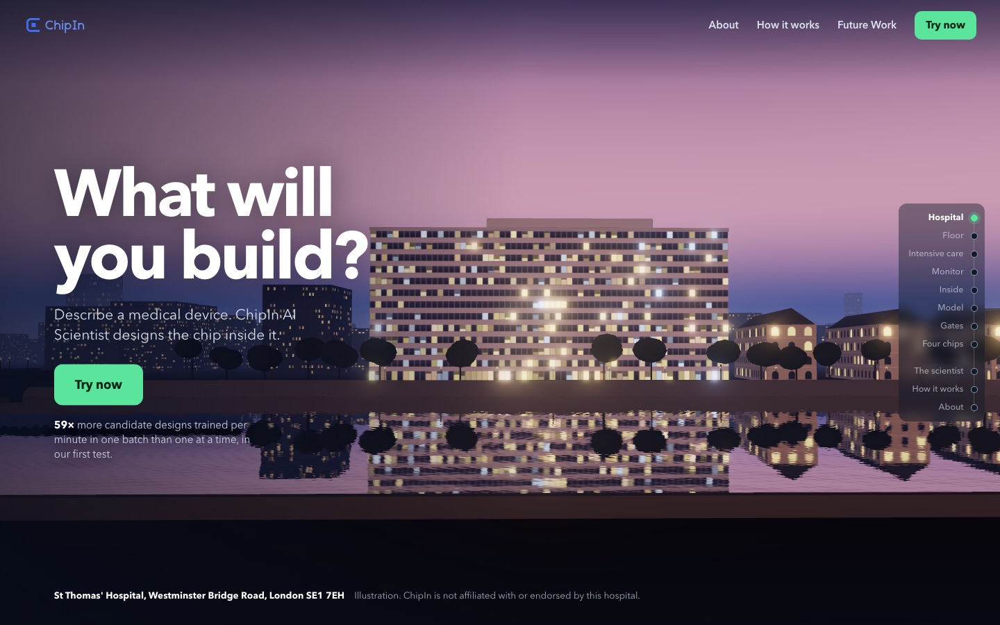
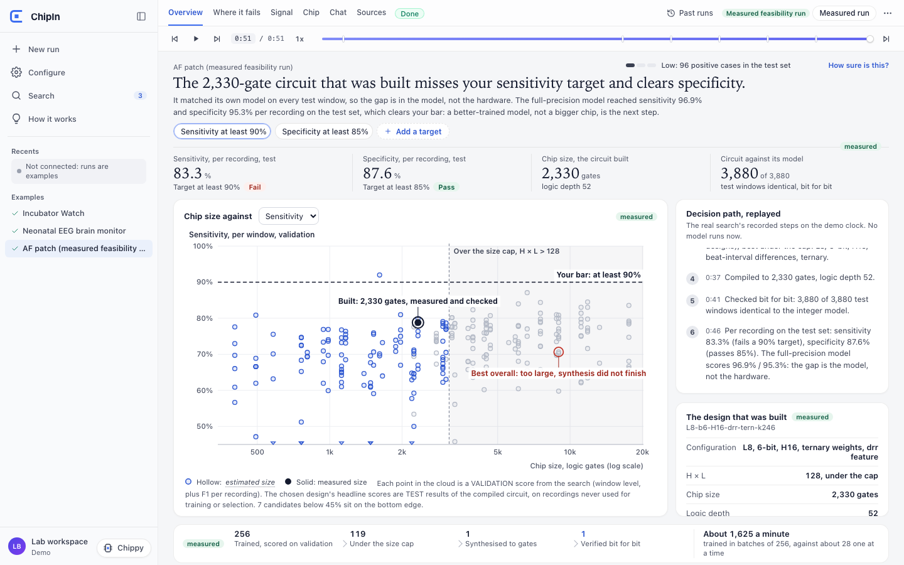
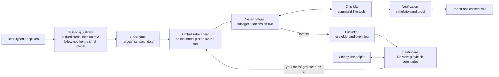
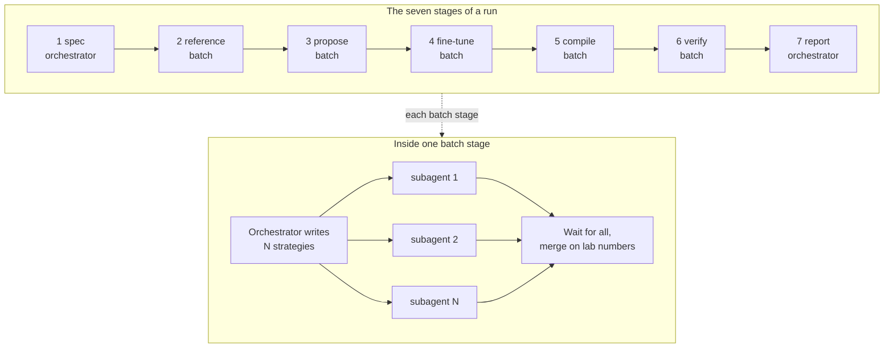

# ChipIn

ChipIn is an AI-scientist environment that designs the small, single-purpose
chip at the core of a medical sensing device. You describe the device. Agents
propose small models, train them, compile them into logic gates with the
weights wired in, check the gates against the model, and report the smallest
chip that clears your targets, and where it falls short.

- Site: <https://chipin.space>
- Dashboard, no install needed: <https://chipin.space/dashboard/variants/i1.html>
- How it works, the technical map:
  <https://chipin.space/how-it-works/variants/w8.html>
- Waitlist: <https://chipin.space/waitlist/>
- Team: <https://chipin.space/#about>





The dashboard above shows the AF patch example: a measured feasibility run
whose 2,330-gate chip clears the specificity target and misses the
sensitivity target.

## How it works



1. **Brief and guided questions.** You type or speak a brief. Five fixed
   steps follow: the device, who uses it and where, the targets, the
   constraints and the data to use. With a backend
   connected, a small model then asks at most three follow-up questions. Each
   has a default, and none blocks the run.
2. **Spec.** The answers become a spec card you can edit: every target is a
   bar the chosen chip is judged against.
3. **Orchestrator and seven stages.** The run's agent is an orchestrator. It
   does the spec and the report itself. Each of the other five stages is one
   batch of subagents, each trying a different strategy, all started at
   once. The orchestrator waits for all of them, merges the best results on
   the lab's numbers and moves on.
4. **Chip lab.** The agents call the lab's tools from the command line: bring
   a model in, synthesise gates, count FPGA LUTs, map to real cell libraries,
   simulate, prove, lay out, package and report.
5. **Verification.** The gate netlist is proved equal to the RTL. The match
   with the model is checked by simulation on the inputs given.
6. **Dashboard.** Every stage, message, tool call, design and cost streams to
   the dashboard live. Recorded runs play back from their own events. Short
   summaries at each level (step, group, subagent, batch, stage, run) open
   down to the full text. You can message the agent while it runs. Chippy,
   a separate helper, answers questions about the runs and moves the page.



| Stage     | What it produces                                 |
| --------- | ------------------------------------------------ |
| spec      | targets, constraints and the data to use         |
| reference | baseline models to compare against               |
| propose   | candidate design families                        |
| fine-tune | trained models, if a Python that can train is set |
| compile   | logic gates for each model, from the lab         |
| verify    | gates checked against the model                  |
| report    | the chosen chip, its numbers and where it fails  |

The run size sets the batch: 3 subagents a stage for Lite, 10 for Pro
(`backend/README.md`, "Fan-out"). The dashboard offers four models by name,
default Opus 5.5, with no automatic choice; the request names its own agent
and model (`dashboard/chipin-models.js` on `gh-pages`).


The full map, with every part labelled, is at
<https://chipin.space/how-it-works/variants/w8.html>. Other versions of the
explanation are in the gallery at <https://chipin.space/how-it-works/>.

## Run it

You need macOS or Linux, `git`, [uv](https://docs.astral.sh/uv/) and
Python 3.12 or newer (uv can install it).

### First run, no key and no model

The stub agent is scripted: it calls no model and costs nothing.

```bash
git clone https://github.com/AMGrobelnik/sota-hack
git clone --depth 1 --branch gh-pages --single-branch \
    https://github.com/AMGrobelnik/sota-hack PATH_TO_SITE_CHECKOUT
cd sota-hack/backend
uv sync --extra dev
uv run chipin-backend run --backend stub --prompt "hello"
```

The last command prints the run as JSON, ending with `"failed": false`, and
writes the run folder under `backend/runs/`.

Then serve the dashboard from your own machine:

```bash
uv run chipin-backend serve --agent stub --site PATH_TO_SITE_CHECKOUT --port 8831
```

It prints one link, `http://127.0.0.1:8831/#token=<token>` (the default port
is 8797). Open the dashboard on the same address with the same token:

```text
http://127.0.0.1:8831/dashboard/variants/i1.html#token=<token>
```

The sidebar reads "Connected to local backend". Type a brief and press Chip
in, answer the questions (the stub's follow-up questions are canned), then
press Run on the spec card. A stub run reports all seven stages. Stop the
server with Ctrl-C.

The published site cannot reach a server on your machine: browsers block an
https page from calling a local address. Serve the site locally as above.

Backend tests, no network and no keys:

```bash
uv run pytest
```

### A real run

A real run uses the default agent, the `claude` command-line agent on the
machine's own login: install it and log in once (`backend/README.md`, "Run
it"). Then, from `backend/`:

```bash
uv run chipin-backend serve --site PATH_TO_SITE_CHECKOUT --env-file PATH_TO_KEYS_FILE
```

Keys are read by name from the environment, `backend/.env` or `--env-file`,
and never printed.

| Name                  | Needed for                              |
| --------------------- | --------------------------------------- |
| `OPENROUTER_API_KEY`  | summaries, questions, Chippy, (a)       |
| `CHIPIN_CHIPLAB_BIN`  | optional: a lab installed elsewhere     |
| `CHIPIN_TRAIN_PYTHON` | optional: a Python that can train       |

(a) and the `openrouter` agent, which runs two of the dashboard's four
models.

The chip lab is optional. Install it as `chiplab/README.md`, section 2,
describes; the backend turns it on whenever `chiplab` is on the agent's
`PATH`. Without a Python that can train, the agent skips the fine-tune stage
and says why. `backend/README.md` is the full reference: routes, events,
fan-out settings, summaries, the helper and the run modes.

## What is measured so far

Every figure below comes from the file named by its letter.

| Figure                                         | File |
| ---------------------------------------------- | ---- |
| AF search: 256 designs trained, 119 under cap  | B    |
| AF chip: 2,330 gates, logic depth 52           | B    |
| AF chip vs model: 3,880 of 3,880 windows equal | B    |
| AF test: sensitivity 83.3%, specificity 87.6%  | B    |
| Training: 1,625.5 vs 27.6 candidates a minute  | B    |
| Second AF chip: accuracy matches published     | C    |
| Second AF chip: 831 GE vs 24,038 published     | C    |
| Neonatal EEG: best 30 of 113 held-out events   | D    |
| Recorded runs: 5, all seven stages done        | E    |
| Recorded runs: 4 to 32 minutes each            | E    |
| Lab spike chip: 2,285 gates, depth 51          | A    |
| Same chip: 862 iCE40 LUTs                      | A    |
| Same chip optimised: 1,405 gates, 1 tile       | A    |
| Gate estimator: held-out r² 0.95               | A    |

- A: `chiplab/README.md`, section 9 (`main`).
- B: `dashboard/data/af-candidates.json` (`gh-pages`).
- C: `dashboard/data/af-baseline.json` (`gh-pages`); method and code in
  `experiments/baselines/af/`.
- D: `dashboard/data/neonatal-eeg.json` (`gh-pages`).
- E: `dashboard/data/runs/index.json` (`gh-pages`).
- F: `index.html` (`gh-pages`).
- G: `how-it-works/variants/y1.html` (`gh-pages`).

**Training throughput.** The 59 times figure is training throughput in one
run: 1,625.5 candidates a minute in one batch of 256, against 27.6 one at a
time on the same GPU, where one at a time is slowed by launch overhead (B).
Against one at a time on the CPU it is about 29 times (F).

**Checks.** On the AF chip, the match with the model is by simulation on the
test windows (B). In the lab, the netlist is proved equal to the RTL, and
the model match is by simulation (A, section 4).

**Design time, different scopes.** Teams without large design staffs
typically see hardware design cycles of 12 to 36 months (OpenROAD paper,
2019, as cited in G). The five recorded runs went from a brief to verified
logic gates in 4 to 32 minutes, on synthetic data (E, G). The runs include no
layout signoff, fabrication or approval, so the two are not the same job.

## Limits

- **The AF chip misses its sensitivity target.** On held-out test recordings
  it scores 83.3% against a 90% target, and passes the 85% specificity
  target. The full-precision model scores 96.9% and 95.3%: the gap is the
  model, not the hardware (B).
- **The second AF chip matches published accuracy; it does not beat it.**
  The intervals are about 8 points wide. Its chip is much smaller but does
  less than the published chip and uses a different cell library, so it is
  not the same function made smaller. On a second database it is below on
  specificity, and a proof for every possible input is not closed (C).
- **Neonatal EEG is a feasibility result.** Every design misses every event
  in at least one held-out baby. It uses one hospital's recordings and is
  not clinical evidence (D).
- **The recorded agent runs use synthetic data** (E).
- **Two other baselines were not reached:** apnea and heartbeat
  classification (`experiments/README.md`).
- **Digital core only.** The lab does not design the analog front end. It is
  not medically certified, and no manufacturing route in it is (A, section
  10). ChipIn covers the step from brief to verified gates, not the whole
  chip design cycle.

## Repo map

| Path           | What it holds                                |
| -------------- | -------------------------------------------- |
| `backend/`     | runs the agents, records runs, local API     |
| `chiplab/`     | the chip lab: model in, verified gates out   |
| `m3/`          | lab speed, install, proof and layout checks  |
| `experiments/` | baseline comparisons on open data            |
| `docs/img/`    | the screenshots in this README               |
| `context/`     | early idea notes (`context/README.md`)       |
| `.github/`     | lab tests and the Tiny Tapeout cloud build   |

The site and dashboard are served from the `gh-pages` branch. The newest
chip lab is on the `ant/chip-lab` branch until it is merged here: its
`chiplab/AGENT.md` lists 44 tools, 36 core and 8 optional extras for data
and training; the copy on `main` documents 43.

## Data, licence and notices

Agent runs use synthetic data. The measured examples use open datasets; each
data file on `gh-pages` (B, C and D) carries its dataset's name, licence and
credit line.

- `backend/`: Apache-2.0, see [backend/LICENSE](backend/LICENSE) and
  [backend/NOTICE](backend/NOTICE).
- `chiplab/`: MIT; its `LICENSE` and `THIRD_PARTY_NOTICES.md` are on branch
  `ant/chip-lab` until that merge.

Built at the SoTA Scientific Parallelism Hackathon, London, November 2026.
